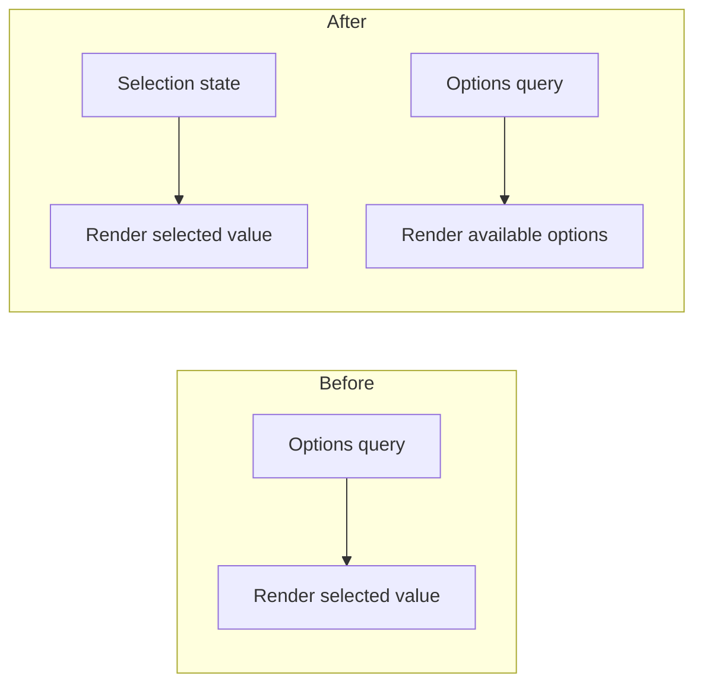

# Pull Request Description

Create a cohesive, current pull-request description with the required
`Motivation`, `QA Instructions`, and `Blast radius` sections and an optional
`Changes` section, using the template's headings, order, and inline comments.

**Style.** Prefer short lists and short, simple sentences. Separate sentence
parts with periods or commas. Copy every template heading verbatim.

**Level of detail.** Treat the diff and commit history as the detailed change
record. Write the PR description as a cohesive overview of the branch in its
current state.

**Flow diagrams.** When the branch changes control flow, data flow, workflows,
state transitions, or component interactions, use GitHub-rendered Mermaid
diagrams as the primary explanation, with brief supporting prose. Embed each
diagram in the existing section it supports, such as `Motivation` for the overall
approach or `QA Instructions` for a verification workflow. Never add a section
or heading just for diagrams. Show before and after when the contrast explains
the change. Otherwise show the resulting flow and label what changed. Include
only relevant actors, branches, and states verified against the diff and
surrounding code. Do not force diagrams for non-flow changes.

## Motivation

**Ticket.** Make the ticket link the first line. Derive its key, summary, and
URL from the current branch and available repository context. Ask when those
details remain unresolved.

**Summary.** Follow the ticket link with one paragraph explaining the goal and
the overall approach used to achieve it.

**Example.**

```markdown
[ACME-1234 Refactor widget loader](https://tracker.example.com/ACME-1234)
Refactor the widget loader to use the new API.
```

## Changes

**When useful.** Include this section when one to five short bullets add context
beyond the diff and diagrams in other sections, such as subtle behavior, timing,
invariants, migration considerations, or rationale for an unusual approach.
Use helpful links. Do not add this section solely to hold a diagram.

**Example.**

```markdown
- Selection state is decoupled from the lazy options query, so the selected
  value renders while options resolve. This is the user-visible fix.
```

## QA Instructions

**Preview environment.** Discover the preview or staging environment from the
repository’s tooling and documentation. Use preview links for affected pages.
State any environment setup required for the reviewer.

**Steps.** Give every affected page a numbered step containing a clickable
markdown link. Link each page once and group its verification actions beneath
that link.

**Route discovery.** Trace each affected UI change through route definitions and
import callers to a real page. Include required feature flags, permissions,
resource IDs, and query parameters. Choose representative routes when several
pages exercise the same code. Confirm each route and preview environment before
using the link.

**Unresolved routes.** Ask the user for the affected page and mark the step
`QA URL: TODO, please provide the page that exercises this change`.

**Concrete resources.** When QA requires a trace, log, event, error, dashboard,
monitor, or similar resource, use the available product or data tools to find a
concrete example and link directly to it. Build the query from fields, tags,
statuses, and attributes used by the changed code. When visibility depends on
account state, link a representative resource with a fallback search and state
the required account state. When a query returns an empty result, state the
result and identify the resource or fixture required for the step.

**Example.**

```markdown
1. Open [Foo Dashboard](https://preview.example.com/dashboards/foo).
   - Select a widget with a chart.
   - Edit the widget and verify the chart renders correctly.
2. Open
   [Another Thingy search](https://preview.example.com/another-thingy?query=some-search).
   - Verify the expected results render.
```

## Blast radius

**Scope.** Use one to five short bullets identifying affected application areas,
shared components, feature gates, and user populations.

## Template

````markdown
## Motivation

<!-- ticket link is the first line -->

[{ticket-key} {ticket-summary}]({ticket-url}) {single-paragraph-description}

<!-- For flow changes, embed a diagram here or in another relevant existing section.
Example below. Omit or replace it to match the branch. -->



The selected value now renders without waiting for options.

## Changes

<!-- OPTIONAL. Include one to five bullets that add context beyond the diff. -->

{context-or-omit-section}

## QA Instructions

<!-- each affected page receives one clickable link with its checks grouped beneath it -->

{manual-testing-steps}

## Blast radius

{one-to-five-affected-areas}
````
